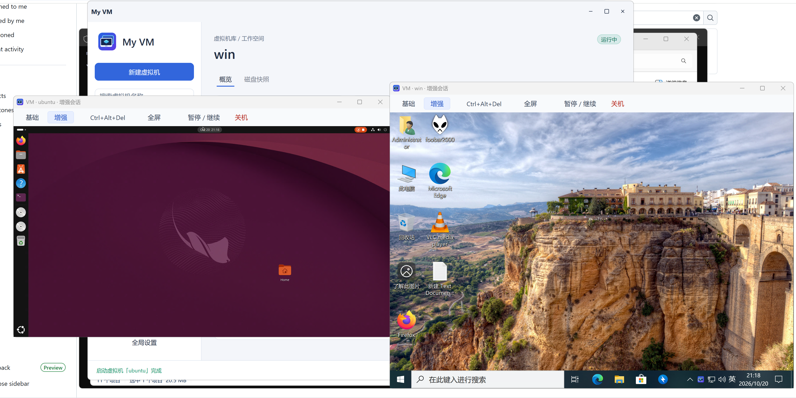
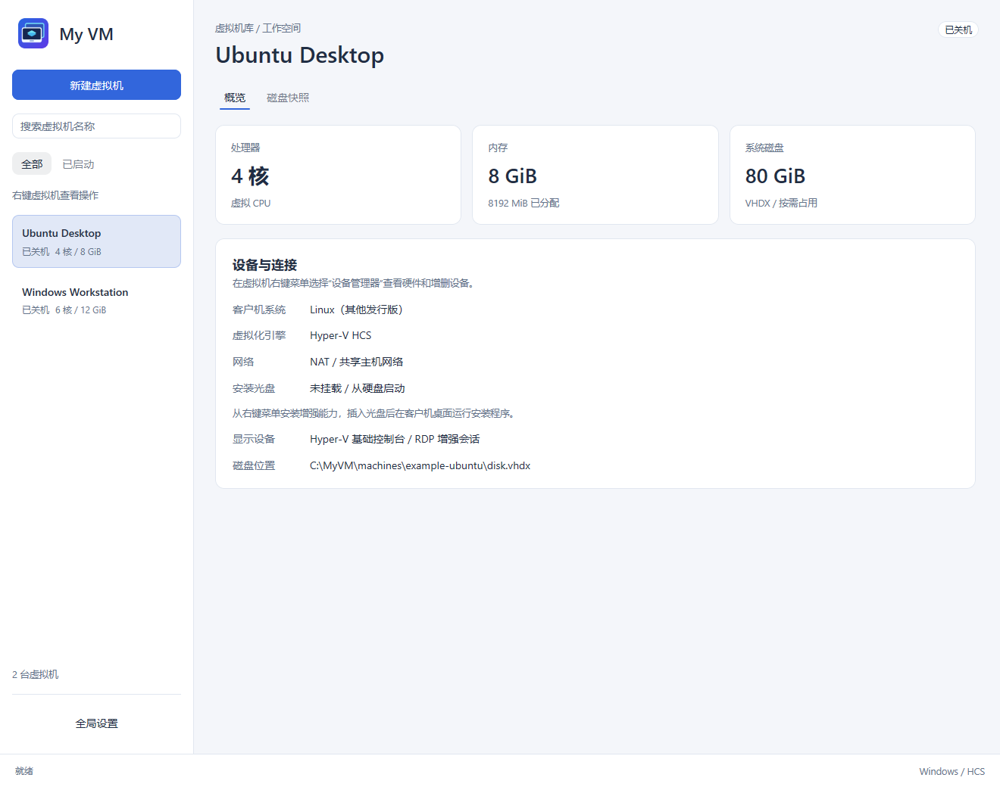
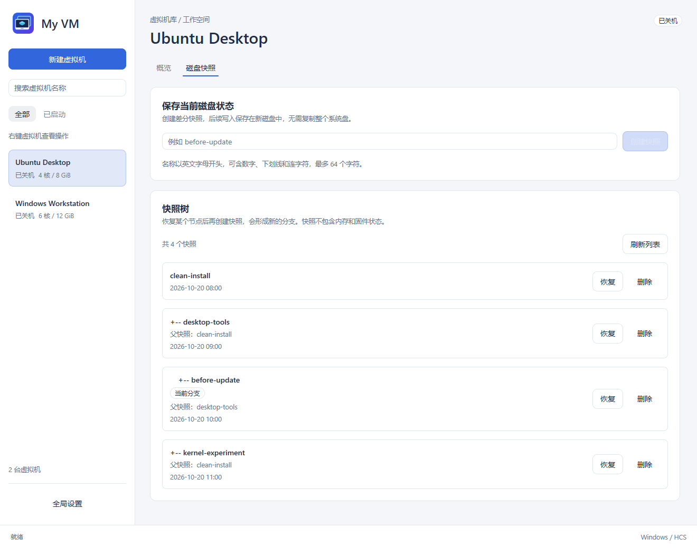
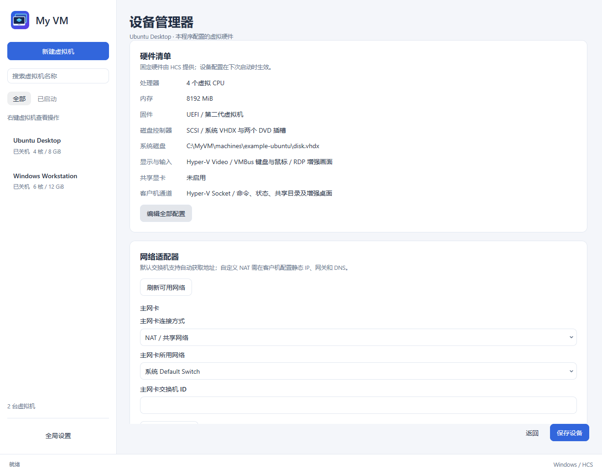

[简体中文](README.zh-CN.md) · [Download](https://github.com/xiaozhu1337/my-vm/releases/latest)

# My VM


A native Windows virtual machine manager for Windows and Linux guests, built on **Hyper-V Host Compute Service (HCS)**. Hardware virtualization, full-state snapshots, and integrated Linux desktops in one application.

## Why My VM?

- **Native Hyper-V performance.** Uses the Windows virtualization stack directly, with hardware-backed CPU, memory, storage, and networking. No QEMU runtime is required.
- **Snapshots with branches.** Save disks, firmware, RAM, and device state, then continue from the saved execution state. VHDX differencing disks preserve branches without copying the entire system disk.
- **Linux enhanced sessions.** Connect to the existing GNOME or KDE Plasma Wayland desktop, with the picture automatically fitted to the window. GNOME also supports dynamic resolution. No replacement desktop or Xfce installation is required.
- **Shared clipboard.** Copy and paste between the host and guest in enhanced sessions. Enable clipboard sharing per VM; supported formats depend on the guest's desktop service.
- **Private folder sharing.** Make selected host folders available inside the guest without copying files back and forth. Configure access per VM, with read-only access by default and optional write access, over a private Hyper-V Socket channel without exposing a TCP file-sharing port.
- **Useful automation.** A separate CLI controls VMs and snapshots, executes guest commands, and transfers individual files in either direction.
- **Responsive management.** Console rendering runs in separate processes. Background jobs reserve the affected VM while other VMs remain manageable.
- **Small guest-tools discs.** Separate Windows and Linux discs install desktop integration and folder-sharing tools. Linux setup downloads only the required dependencies from the guest's configured APT repositories for Ubuntu/Kubuntu 26.04 and 26.10 amd64.

## Screenshots

The first screenshot shows Windows and Ubuntu running side by side in enhanced sessions. The management views below use example VM configurations and snapshot data. The current application UI is in Simplified Chinese.

**Windows and Ubuntu enhanced sessions**



**VM library and hardware overview**



**Differencing snapshot branches**



**Per-VM device manager**



## Download and run

Download **`my-vm-windows-amd64.zip`** from [Releases](https://github.com/xiaozhu1337/my-vm/releases/latest). The ZIP contains:

```text
my-vm/
  my-vm.exe
  my-vm-cli.exe
  my-vm-guest-tools-windows.iso
  my-vm-guest-tools-linux.iso
  README.md
  README.zh-CN.md
  THIRD-PARTY-NOTICES.txt
  licenses/
  SHA256SUMS.txt
```

Extract the complete archive into a writable folder, keep the enhancement ISOs next to the executable, and run **`my-vm.exe` as administrator**. A SHA-256 checksum for the ZIP is provided alongside the download.

### Host requirements

- An x64 Windows host with HCS schema 2.5 or later: Windows 11 Pro/Enterprise or Windows Server 2022 and later.
- Hardware virtualization enabled in firmware, the full Hyper-V feature enabled, and a restart after enabling it.
- The `vmcompute` and `hns` services available. Automatic NAT uses the Hyper-V **Default Switch**.
- Live snapshots additionally require the host's native backing-file fork API. Unsupported hosts report an error instead of silently copying the full disk.

### First VM

1. Create a VM, select a Windows or Linux installation ISO, and assign CPU, fixed memory, disk, and networking.
2. Right-click the VM to start it and open the basic console. Install the operating system normally.
3. Choose **Install enhancements** from the VM's context menu to attach the appropriate guest-tools disc.
4. In Windows, run `install.exe` from the disc as the logged-in desktop user and approve elevation. Windows enhanced sessions require a guest edition with an RDP server and an account with a login password.
5. In Ubuntu/Kubuntu, connect the guest to the internet, then run `python3 "/path/to/mounted/disc/install.py"` from a logged-in GNOME/KDE Wayland desktop. Run it as your desktop user, without `sudo`; approve the permission prompt when requested. Setup uses the guest's existing APT repositories and signature checks; configure a system APT proxy if your network requires one. Download or installation failures stop setup with an error; fix the network or package issue and rerun it.
6. Reopen the console. Automatic mode starts with the basic console and tries an enhanced session when appropriate. The toolbar also lets you switch modes manually.

GNOME/KDE tools generate separate connection credentials and exchange them through the VM's private channel. Keyring/wallet approval, unknown-certificate confirmation, guest login, and unlocking may still need user interaction. Clipboard formats depend on the guest's desktop service.

With GPU sharing enabled, **Install enhancements** collects drivers from the current host and prepares a private, matching disc before mounting it. Release images contain no host-specific GPU driver binaries. Missing files, copy/checksum errors, or changed host drivers stop preparation and report the problem; the existing disc stays in place. Preparation needs extra disk space for temporary files and the new ISO. Linux GPU-PV currently targets NVIDIA GPUs with compute capability 8.0 or later and the supported `7.3.0-9-generic` guest kernel; automatic collection does not guarantee hardware compatibility.

Windows preparation excludes Linux libraries, host-only kernel drivers, installers, caches, and logs. Vendor runtime DLLs and data remain, so a private disc can still occupy several GiB. Only unused images generated during the current manager session are automatically removed; existing images from earlier sessions are retained.

Closing a console leaves its VM running. Closing the manager offers a normal shutdown of active VMs and waits for them to stop.

## How is memory allocated?

Each VM has one fixed memory capacity (`memory_mib`), set at creation or edited while powered off. It stays fixed while the VM is running. Existing configurations retain their `memory_mib` value; retired dynamic-memory and maximum-memory fields are ignored on import and omitted on save. Runtime snapshots require the same memory capacity as the current configuration. Saved running or paused states created with the retired dynamic-memory backing cannot be restored; their disks remain available for cloning and a fresh boot.

## Snapshots: what is saved?

New snapshots contain **disks and UEFI firmware**. Creating one while running or paused also saves **RAM and device state**, so restoration continues from the saved execution state. Creation pauses the guest and then restores its previous running or paused status; pause duration depends on memory size and storage speed. GPU sharing currently prevents runtime state capture; power off before creating a snapshot with GPU sharing enabled.

The snapshot page uses fixed-size nodes and scrolls when branches exceed the viewport. A separate current-position node marks the working state. Select a saved node to inspect, restore, or delete it; selection alone never changes state. To create another branch from an older snapshot, restore it first, then create a new snapshot. Existing branches remain available.

- Running snapshots resume running, paused snapshots remain paused, and powered-off snapshots remain off. Older disk-only snapshots retain their original restore and restart behavior.
- Restore discards unsnapshotted changes at the current position. Runtime restoration requires compatible hardware, networking, and mounted media, checked before stopping the current VM. External services, host shared folders, and other VMs are not rolled back.
- Up to 16 named restore points per VM. Deleting a name retains disk layers still needed by another branch or the active disk, so space may not be reclaimed immediately.
- Keep the entire disk chain, saved `state-*` files, and `storage.yaml` together. RAM files contain sensitive guest data and need equivalent protection. Online chain compaction is not implemented.
- Cloning requires choosing the current working state or a historical snapshot. The independent clone copies the selected disk and available saved firmware, and inherits neither the snapshot tree nor saved RAM.

## Command line

Run the CLI as administrator from the extracted folder; it works without opening the GUI. GUI and CLI share the public `my-vm/library` API and automatically connect to the same background core service. Output defaults to JSON, with `--format yaml` available. Use a VM name or ID from `list`:

```text
my-vm-cli.exe --format yaml template > "C:\Work\machine.yaml"
my-vm-cli.exe create "C:\Work\machine.yaml"
my-vm-cli.exe list
my-vm-cli.exe --wait start "Ubuntu Desktop"
my-vm-cli.exe snapshot create "Ubuntu Desktop" before-update
my-vm-cli.exe snapshot list "Ubuntu Desktop"
my-vm-cli.exe snapshot restore "Ubuntu Desktop" before-update
my-vm-cli.exe snapshot delete "Ubuntu Desktop" before-update
my-vm-cli.exe exec "Ubuntu Desktop" /usr/bin/uname -a
my-vm-cli.exe copy-to "Ubuntu Desktop" "C:\Work\hello.txt" /home/user/hello.txt
my-vm-cli.exe --help
```

Guest commands and file transfer require installed, running guest tools. Snapshots and ordinary VM control use the host backend. The CLI also covers configuration, cloning, memory queries, enhancement media, networks, and global settings. See the [CLI reference](docs/command-line.md) and [library architecture](docs/architecture.md).

## Build from source

Development tools are managed with [mise](https://mise.jdx.dev/). On Windows x64:

```text
mise install go@1.27.3
mise install python@3.12
mise exec go@1.27.3 -- go build -trimpath -ldflags=-H=windowsgui -o "dist/my-vm.exe" ./cmd/my-vm
mise exec go@1.27.3 -- go build -trimpath -o "dist/my-vm-cli.exe" ./cmd/my-vm-cli
```

To also build the portable enhancement discs:

```text
mise exec python@3.12 -- python -X utf8 "scripts/build.py"
```

The first media build downloads portable GPU module source and license texts; later builds verify and reuse `dist/guest-payload`. It does not collect Ubuntu packages or require Docker/WSL. Standard `HTTP_PROXY`/`HTTPS_PROXY` settings are respected. Linux guests need network access during enhancement installation. GPU-PV requires compatible guest kernels and host-matched drivers; support is hardware-dependent.

```text
mise exec go@1.27.3 -- go test ./...
mise exec go@1.27.3 -- go vet ./...
```

## Data and scope

Configuration lives in `%APPDATA%\my-vm` as YAML. Errors are written asynchronously to `logs\my-vm.log` beside the executable. Removing a VM from the library keeps its disks and snapshots.

This project currently targets **Windows x64 hosts**. It does not provide unattended OS installation, automatic qcow2 conversion, or universal GPU compatibility. The background core owns HCS handles and survives GUI/CLI client exits. An abnormal core-service exit terminates its HCS VMs; shut guests down normally before stopping the service or closing the host session.

## Todo

- [ ] Support Linux hosts.
- [ ] Support macOS hosts.

These are planned host platforms; the current release supports Windows x64 hosts.

## Acknowledgments

The interface uses [MyGo](https://github.com/egoist/mygo) and [Onevra](https://github.com/oneo-me/onevra). HCS, RDP, memory, and GPU implementation paths reference [NanaBox](https://github.com/M2Team/NanaBox). The project icon is generated by this repository's own script.
