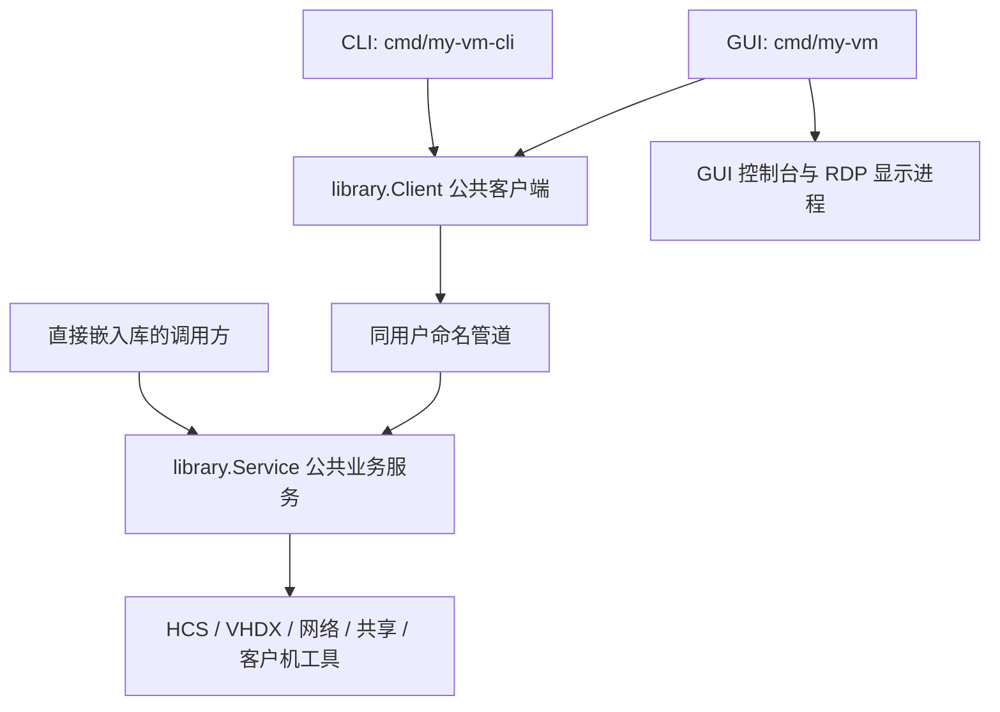

# 核心库、GUI 与 CLI

应用采用三个明确的职责边界：`my-vm/library` 提供公共业务接口，GUI 展示及收集交互，CLI 将自动化指令映射为相同接口。核心库只支持当前的 Windows x64/HCS 后端，不依赖 MyGo、Onevra 或控制台窗口。



## 进程与依赖

`library.Service` 持有唯一运行管理器、配置写入锁、任务预留和增强介质登记。`my-vm-cli.exe serve` 是服务启动入口，只创建库服务和本地传输；不会加载 GUI。`library.Connect(ctx)` 自动连接当前用户的服务，必要时启动同目录 CLI 的 `serve` 模式。GUI 和 CLI 可以同时使用，CLI 可以单独分发运行；增强介质仍需对应 ISO。

后台服务不会因某个客户端结束而退出。GUI 的正常退出继续提供全部关机确认；CLI 退出不影响已启动的虚拟机。更新或结束 Windows 用户会话前先正常关闭虚拟机。终止后台服务会关闭 HCS 句柄，效果等同断电；GUI 崩溃本身不再持有这些句柄。

GUI 保留界面渲染、对话框、未保存草稿、分页视图及控制台窗口管理。RDP、窗口焦点和显示进程不进入核心。GUI 轮询状态、任务进度和配置，观察会话 RuntimeId 的变化后重开已有控制台，覆盖 GUI 或 CLI 发起的快照恢复及恢复失败后的回退重启。

## 公共接口

公共包路径为 `my-vm/library`。主要接口：

```go
func NewService(root string, log io.Writer) *Service
func (s *Service) Execute(ctx context.Context, r Request) (any, error)
func (s *Service) Listen() (*Server, error)
func (s *Service) ServeHTTP(w http.ResponseWriter, r *http.Request)

func Connect(ctx context.Context) (*Client, error)
func (c *Client) Execute(ctx context.Context, r Request) (json.RawMessage, error)
func (c *Client) Exec(ctx context.Context, selector string, input Command) (CommandResult, error)
func (c *Client) CopyTo(ctx context.Context, selector, source, target string, overwrite bool) error
func (c *Client) CopyFrom(ctx context.Context, selector, source, target string, overwrite bool) error
func (c *Client) Close()
```

`Service.Execute` 是主机业务入口；`Client` 将请求送到同一个入口，并提供客户机命令及流式文件接口。传输层使用标准 HTTP 编解码，通过本地命名管道传输，不监听 TCP 管理端口。客户机状态订阅继续使用原有 NDJSON 协议。

`Request` 的操作与 CLI 对应如下：

| 核心操作 | CLI | 结果/用途 |
| --- | --- | --- |
| `list`, `status`, `state`, `get` | 同名命令 | 分页摘要、单台状态、完整配置 |
| `create`, `update`, `clone`, `remove` | 同名命令 | 创建、编辑、独立复制、移除登记 |
| `start`, `stop`, `kill`, `pause`, `resume`, `shutdown-all` | 同名命令 | 完整生命周期 |
| `snapshots`, `snapshot-create`, `snapshot-restore`, `snapshot-delete` | `snapshot list/create/restore/delete` | 分支快照 |
| `memory` | `memory` | 运行会话的固定内存查询；内存容量通过关机 `update` 设置 |
| `enhancements`, `media-mount` | `enhancements`, `media mount` | 驱动收集、介质准备及挂载 |
| `networks`, `network-create`, `network-delete`, `adapters` | `network list/create/delete`, `adapters` | NAT 与宿主网络 |
| `settings`, `settings-update` | `settings`, `settings set` | 全局缓解配置 |
| 客户机 `Exec`, `CopyTo`, `CopyFrom` | `exec`, `copy-to`, `copy-from` | 客户机命令及文件流程 |
| `config`, `display-info`, `runtime` | GUI/内部调用 | 配置分页、显示元数据、客户机运行通道 |

`Machine`、`Share`、`NetworkAdapter`、`COMPort`、`Snapshot`、`Page[T]`、`Item` 和命令输入/输出类型由公共包导出。`Request.Machine` 是完整配置；CLI 的部分 YAML 更新由 CLI 先读取当前值并合成完整配置。`Request.Expected` 可提供原始版本，核心会在保存前拒绝过期版本。

列表默认 20 条，最多 100 条，返回 `Page[T]{Total, Items}`。摘要只包含本页面需要的信息。GUI 的 `Configuration`、`Refresh` 等客户端便利方法逐页读取并在客户端聚合；绘制时的 `State`、`Memory`、`Progress`、`Active` 使用最近一次刷新缓存，避免绘制线程执行 I/O。

## 使用共享服务

```go
ctx, cancel := context.WithTimeout(context.Background(), 30*time.Second)
defer cancel()
client, err := library.Connect(ctx)
if err != nil {
    return err
}
defer client.Close()
result, err := client.Execute(ctx, library.Request{Action: "list", Limit: 20})
if err != nil {
    return err
}
var machines library.Page[library.Item]
return json.Unmarshal(result, &machines)
```

直接嵌入库的程序可创建 `NewService(root, log)` 后调用 `Execute`，也可通过 `Listen` 对客户端提供服务。同一数据目录只能由一个服务负责运行和写入；与正在运行的应用集成时应使用 `Connect`。公开的旧配置读写辅助函数只用于离线配置，不应绕过运行服务直接写文件。库调用方负责服务生命周期及日志写入器；现有可执行入口使用异步文件日志，位于程序目录的 `logs`。

## 并发与数据保护

- 同一虚拟机的冲突业务串行执行，等待锁可由上下文取消；不同虚拟机可并行。复制还会预留调用方指定的目标 ID。网络变更和全部关机使用全局门控。
- 名称在等待虚拟机锁前解析为固定 ID，锁后按该 ID 读取最新配置，避免并发重命名让操作指向另一台。
- 配置保存只在短临界区内读取并合并最新清单。版本、唯一名称、共享、网卡和串口占用均由核心统一校验，文件持久化使用原有原子写入流程。
- 管理配置完整传输宿主共享路径；客户机共享协议继续隐藏路径，目录访问限制在宿主端执行。
- 移除只删除清单登记。复制或登记失败保留已创建磁盘并返回恢复路径；快照使用原有恢复记录和失败回退。
- 已发布的增强介质可能仍被其他客户端草稿引用，因此保留。只有当前服务创建且未发布、未使用的孤立介质可回收；跨客户端介质租约尚未实现。
- CLI 超时不代表原子磁盘操作必然回滚；结果未知时查询实际状态再决定重试。客户端不会自动重复执行变更请求。

## 验证

```text
mise exec go@1.27.3 -- go test ./...
mise exec go@1.27.3 -- go vet ./...
mise exec go@1.27.3 -- go list -deps ./library
mise exec go@1.27.3 -- go list -deps ./cmd/my-vm-cli
```

后两条依赖树不应包含 MyGo、Onevra 或 `internal/console`。库测试通过真实 `Service` 和内存传输验证配置、分页、并发、版本冲突、共享路径、介质回收及安全边界；CLI 测试验证命令映射、导出导入、JSON/YAML、退出码和二进制文件传输；GUI 测试保留布局、草稿、操作禁用与关闭流程，并验证原始版本和会话变更检测。

真实 HCS、GPU、客户机增强和 RDP 仍需在兼容主机验收，当前支持范围见 [README.zh-CN.md](../README.zh-CN.md)。普通单元测试不启动现有客户机，也不替换用户现有数据。CLI 完整操作示例见 [command-line.md](command-line.md)。
